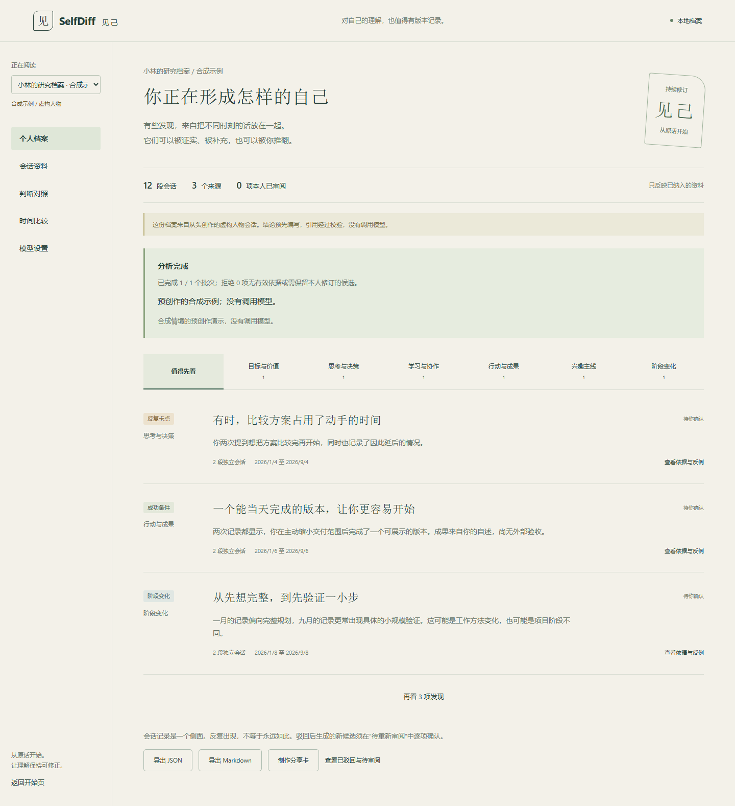

# SelfDiff · 见己

**Your understanding of yourself deserves a version history.**

A local personal research archive built from your AI conversations. Find recurring blockers, conditions that help you succeed, and changes over time. Trace observations to exact quotes, inspect alternative explanations, and correct the conclusions yourself.

[中文说明](README.md) · [Import formats](docs/import-formats.md) · [Privacy](docs/privacy.md)



## The idea

Two conversations mention comparing options without starting. SelfDiff proposes a bounded observation: unclear requirements may turn comparison into a blocker. You add a counterexample: when the goal is clear, you start quickly. Your correction becomes a new version, while the original words remain available.

The demo is entirely authored synthetic material. It is stored separately from your own conversations.

## Features

- Six profile dimensions: goals and values, thinking and decisions, learning and collaboration, action and results, interests, and change. Missing evidence stays missing.
- Exact quote, role, version and workspace validation. Recurring patterns need at least two independent conversations, not a confidence score.
- Confirm, partially agree, reject, rewrite, and reopen findings. Preserve your revision history and rejected topic keys.
- Challenge a self-belief using supporting, opposing and contextual evidence.
- Compare two date windows, keeping unknown timestamps out of temporal conclusions.
- Full JSON/Markdown exports; separate, explicitly reviewed HTML share cards without automatic raw quotes or source links.
- Single-worker analysis with progress, cancellation, interruption handling and coverage reporting.

## Run

Python 3.10+ is required. The wheel includes the built UI; end users do not need Node.js.

```sh
python -m pip install https://github.com/wind127/selfdiff/releases/download/v0.1.1/selfdiff-0.1.1-py3-none-any.whl
python -m selfdiff.cli serve
```

Open the one-time startup link printed by the command. The server binds only to `127.0.0.1:8765`; data defaults to `~/.selfdiff`. Choose the synthetic demo to explore without a model key.

For your own data, import and search work offline. Analysis requires your own compatible model endpoint and model name. Supply `SELFDIFF_API_KEY` in the server process environment when needed; the app neither persists nor reads it back to the UI. `SELFDIFF_BASE_URL` and `SELFDIFF_MODEL` are optional environment defaults. HTTPS endpoints and loopback HTTP endpoints are supported. The provider must support `/chat/completions` and JSON-object output.

## Supported inputs

| Source | Tested format family |
|---|---|
| Codex | JSONL session_meta/response_item text messages, or event-only records |
| Claude Code | JSONL user/assistant messages and text blocks; tool results excluded |
| WorkBuddy | JSONL type:message with role/content, directly or in message |
| ChatGPT | Official conversations.json/ZIP, following current_node's selected branch |
| Claude web | Official conversations.json/ZIP with chat_messages and human/assistant senders |
| DeepSeek, Doubao, Qwen Office and others | Normalized JSON or explicit User:/Assistant: Markdown/text |

These adapters target fixture-tested format families. There is no browser credential extraction, whole-disk crawl, or native cloud-account history scanner. Unknown formats produce warnings/errors rather than invented support.

## Privacy and limits

Data, evidence and revisions remain in local SQLite. Model calls occur only after you start them, sending selected user messages and candidate findings to your configured provider. There is no account, CDN, default telemetry or automatic public sharing.

Findings reflect imported material, not your complete real-world identity. They need your review. Assistant-generated output is not proof of your ability or action; quotes, hypotheticals and role-play are not personal facts. Heuristics and models can still misclassify content. No clinical diagnosis or unsupported personality/ability ranking is provided.

Deleting a conversation conservatively clears generated insights, revisions, snapshots and analysis caches in that workspace, preventing indirect remnants. Remaining sources can be reanalyzed. External source files and previously downloaded exports are not deleted.

## Develop

Python 3.10+, Node.js 22.12+. Activate a dedicated virtual environment first:

```sh
python -m pip install --upgrade pip
python -m pip install -r requirements-dev.lock
python -m pip install --no-deps -e .
npm --prefix web ci
python scripts/build_release.py
python -m pytest -q
npm --prefix web run typecheck
```

Install Chromium with `npx playwright install chromium` from `web/`, then run `npm run test:e2e`. Browser tests use synthetic conversations and a local fake HTTP model, with a test-only key replacing inherited credentials. They validate the application, not a live provider or psychological inference quality.

See [development](docs/development.md), [contributing](CONTRIBUTING.md), and [MIT license](LICENSE).
